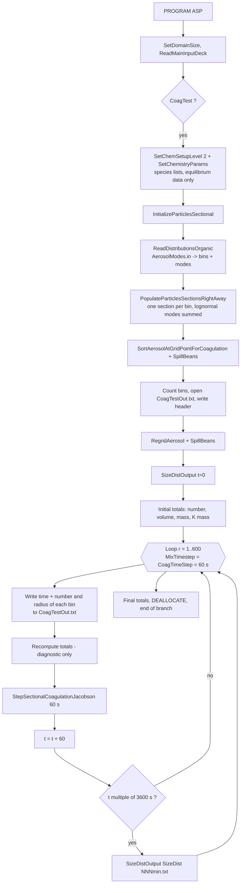

# ASP Model — Information Flow for `DevelopmentDriver.f90` with `CoagTest = .TRUE.`

Source basis: `common_ASP` branch `asp_v_2.2.1` (patches 00–10 applied). Line numbers refer to that tree.

## 1. Scope and purpose

This document traces the flow of control and data through the ASP source tree when:

- `DevelopmentDriver.f90` (`PROGRAM ASP`) is the main program, and
- the run-control flag `CoagTest` (read from the main input deck, stored in `ModelParameters`) is `.TRUE.`

In this mode ASP does **not** run chemistry, condensation or transport. It builds a static sectional (binned) aerosol population from `AerosolModes.in`, then lets the particles **coagulate only** for a fixed 10 hours in 1-minute steps and writes the evolving number and radius of each bin, plus hourly size-distribution snapshots. Its purpose (per the comment in the driver) is to compare against an analytic coagulation solution. No numeric values from any input deck are used below, only the structure of what is read, computed and written.

## 2. High-level flow

## 3. Step-by-step description

### 3.1 Program entry and branch selection

`PROGRAM ASP` calls `SetDomainSize`, `SetFileHandleCounter(12)` and `ReadMainInputDeck()`. The deck sets the run-mode flags (`EulerianBoxModel`, `OpticalPropertiesModel`, `LagrangianParcelModel`, `ThermoTest`, `CoagTest`, `CondTest`, `SmogChamberModel`), the environment (T, P, RH), and the coagulation settings listed in section 4. The `IF / ELSE IF` chain then enters the `CoagTest` block (`DevelopmentDriver.f90` ≈ lines 1200–1383). A line "Coagulation Test Selected." is written to the transcript.

### 3.2 Chemistry setup (reduced)

`CALL SetChemSetupLevel(2)` then `CALL SetChemistryParams` (patch 07). `SetChemistryParams` reads the gas, aqueous, organic and hydrophilic-organic species definitions and the aqueous equilibrium reactions, sets the dissociation reactions, and (level 2) skips the gas- and aqueous-phase ODE sets and Jacobians, which this mode never integrates. Results used later: species name lists, molecular masses, densities (`AqMolecularMass`, `SolidSaltDensity`, `OrgDensity`, `AqOrgDensity`, ...), the equilibrium list (`AqEquilibriaList`) and the counts (`HowManyAqChems`, `HowManyOrgChems`, ...).

Note: unlike the optical branch, `SetAllDissolution` is **not** called here.

### 3.3 Building the initial aerosol population

`InitializeParticlesSectional` (`LagrangianAerosols.f90`):

1. Sets the empty particle list and the initial density (`SetInitialDens`).
2. `ReadDistributionsOrganic()` parses `AerosolModes.in`: a Lagrangian/sectional flag, an input-type flag (relative molar abundance or mass burden), the sectional/Lagrangian size cutoff, the number of bins, the lowest-bin cutoff, then one line per aerosol mode (number concentration, size parameters, composition). It calls `SetSectionalParameters`, which fills `BinEdges` and `HowManyBins`, and sets `ThermoBulkMode = .FALSE.`
3. `PopulateParticlesSectionsRightAway(.FALSE.)` creates one `Particle` section per bin (`MakeSection`: edges from `BinEdges`, number 0, all composition arrays allocated and, since patch 09, optical arrays zeroed). For each mode it then adds a lognormal number and mass share to each bin (bins with fewer than 1e-6 particles/cm3 are skipped) and fills `AqChems`, `OrgChems` and `AqOrgChems` (mol per particle) from the composition. If the deck's `Monodisperse` flag is set it instead makes a single particle with `MakeMonodisperse`.

Result: a singly linked list `Particles%First -> ...` of N sections (N = `HowManyBins` in sectional mode) holding `NumberOfParticles` (cm⁻³), edges, composition and derived radius/density.

### 3.4 Sorting, diagnostics, first regrid

- `SortAerosolAtGridPointForCoagulation()` (`SortAerosol.h`) checks the list is ordered by population id, then by bin edges, and only does a bubble-style relink when it is not. Result: smallest to largest.
- `SpillBeans()` prints a full-state diagnostic dump (not used by later steps).
- The driver counts the bins (`NumBins`), allocates `NumConc(NumBins)` (unused afterwards) and gets `TEMP = GetTemp()`.
- It opens `CoagTestOut.txt` (unit from `GetFileHandle`) and writes a header: `Time`, then a `Number` and `Eff. Radius` column pair per bin.
- `RegridAerosol()` is called once (see 3.6), then `SpillBeans()`, then `SizeDistOutput(0, "SizeDist0min.txt")`.
- `MixTimestep = 60` and `CoagTimeStep = 60` are **hard-coded in the driver**. The coagulation step read from the input deck (`CoagStep`) is not used in this branch (it is used in the Eulerian, Lagrangian and chamber branches).
- Initial totals (number, volume, mass, potassium mass) are summed over sections. Potassium uses `FindChem("K+",1)` and `FindChem("K2SO4",1)`, so the test assumes those species exist in the aqueous species list. These totals are diagnostics only (their `WRITE`s are commented out).

### 3.5 Main time loop (600 iterations)

`DO r = 1, INT(10*60*60/MixTimestep)`, i.e. 600 passes of 60 s. Each pass:

1. **Time-series output.** `IF (MOD(t,60.0) <= 0.05)` is true every pass with a 60 s step (the comment says every 10 minutes, the code does every minute). It writes `t/60`, calls `SortAerosolAtGridPointForCoagulation`, then writes `NumberOfParticles` and `EffectiveRadius/micron` for every bin to `CoagTestOut.txt`.
2. **Totals.** Sums number, volume, K2SO4 and K masses over sections with particles. Results are not used (diagnostic remnants).
3. **`CALL StepSectionalCoagulationJacobson(CoagTimeStep)`** (section 3.6).
4. `t = t + MixTimestep`.
5. **Hourly snapshot.** `IF (MOD(t,3600.0) <= 0.05)` calls `SizeDistOutput(t, "SizeDist<minutes>min.txt")`. Over the run: t = 0 plus ten hourly files (60, 120, ..., 600 min), eleven in total.

After the loop the driver recomputes final totals, deallocates `NumConc` and `OutFH`, and falls out of the `ELSE IF` chain to the end of the program.

### 3.6 `StepSectionalCoagulationJacobson` (`Coagulation.f90`)

Semi-implicit scheme of Jacobson (*Fundamentals of Atmospheric Modeling*, 2nd ed., Sect. 15.2) on the sorted section list. Let N = number of sections (`HowManyLinks`), S = number of aqueous species (`HowManyAqChems + HowManyAqCations + HowManyAqAnions`), O and A the hydrophobic and hydrophilic organic counts.

| # | Stage | What happens | Cost |
|---|---|---|---|
| 0 | Guards | Returns immediately if `DoCoagulationFlag` is false or `ThermoBulkMode` is true; sorts the list; returns if all sections are empty. | O(N) |
| 1 | Allocate | Per-call allocation of `CoagArray(N,N)`, `VolumeFractions(N,N,N)`, `AqVolConc(N,S)`, `OrgVolConc(N,O)`, `AqOrgVolConc(N,A)` and several length-N vectors. | alloc per step |
| 2 | Monodisperse shortcut | If `Monodisperse`: one scalar kernel, explicit number update, concentration rescale, `RecalculateRadius`, return. | O(1) |
| 3 | **Kernel array** | For all (I, J): zero if either section is empty; else `CoagKernel` if `ConstantKernel`; else `CoagKernBrownianDiff + CoagKernGravCollection`. | **N² kernel calls** |
| 4 | Volume bookkeeping | Average solution density over non-empty sections. Per section: single-particle volume (4π/3 r³), number, volume concentration, and each species converted to cm³ of that species per cm³ of air (water and ions with the average solution density, solid salts with `SolidSaltDensity`, organics with their densities). | O(N·(S+O+A)) |
| 5 | **Volume fractions** | `VolumeFractions(I,J,K)`: fraction of the volume of a merged I+J particle assigned to bin K (linear split between the two neighbouring bins). | O(N³) |
| 6 | Total volume and number | Loss/gain sum over bins J (`LowerSum`) and gain from smaller bins (`UpperSum`, with `InnerSum` over I<K), then implicit update `V_K = (V_K + dt·Upper)/(1 + dt·Lower)`; number = V/particle volume. | O(N³) |
| 7 | **Per-species update** | The same sum structure repeated for every aqueous species, hydrophobic organic and hydrophilic organic species. | O((S+O+A)·N³) |
| 8 | Conservation checks | Total volume and summed species volume must agree before and after to 1e-4, otherwise `ERROR`. Negative concentrations also raise `ERROR`. | O(N) |
| 9 | Write back | For bins with number > 0: set `NumberOfParticles`, convert species back to mol/particle, then `RecalculateRadius`. Empty bins get zeroed. | O(N) × RecalculateRadius |
| 10 | **`RegridAerosol()`** | See below. | O(N) × RecalculateRadius (+ equilibrium on moves) |
| 11 | Free | Deallocates the arrays (`InitNumConc` and `SumVolConc` are not explicitly deallocated here). | |

**Kernel call chain (stage 3).**

- `CoagKernBrownianDiff` (`CoagulationKernels.h`): grid lookups (`GetDynamicViscosityOfAir`, `GetTemp`, `GetAirDensity`), `ParticleKnudsen` ×2, Cunningham-type slip factor, diffusivities, `ParticleMass` ×2 (a loop over all species of the particle), mean-free-path and transition-regime correction, then a `ReynoldsNumber` correction.
- `CoagKernGravCollection`: `CollisionEfficiency` (several `TerminalVelocity` and one `ReynoldsNumber` calls), then two more `TerminalVelocity` calls for the velocity difference.
- `TerminalVelocity` calls `ReynoldsNumber`, which calls `CunninghamSlipCorrectionFactor` (a `dexp`) and, depending on the regime, evaluates `dLog`, a polynomial and `dExp`.

**`RecalculateRadius`** (`ParticleAttributes.h`): returns early for empty sections, otherwise calls `ParticleDensity` (volume and density from composition, with loops over the equilibrium list) and `SurfaceTension` (which calls `CalculateIonicStrength`, `KusikMeissner` and `MeanActivity`, the thermodynamic routines optimized earlier).

**`RegridAerosol`** (`SortAerosol.h`):

1. Re-sorts.
2. Calls `RecalculateRadius` on every section again.
3. For each non-empty section: if its radius now exceeds its upper edge (and number > 2e-4), it moves essentially all of its particles and mass to the next larger bin (leaving 1e-4 behind), recomputes `ParticleDensity` for both, and runs `FindElectrolyteEquilibrium` on both. If its radius fell below its lower edge, the same happens toward the next smaller bin (with `WRITE` diagnostics).
4. Resets each section's temperature from the grid (`GetTempfromGrid`).
5. A final loop checks the first particle for "number without mass".

### 3.7 Output routines

- `SizeDistOutput(t, name)` (`OutputRoutines.f90`): one header row plus one row per bin: time, gas species, edges, effective radius, number, and totals of the main aerosol components.
- `SpillBeans()` writes RH, density and a full state dump to standard output (no unit passed in this branch).
- `CoagTestOut.txt` is written directly in the driver (section 3.5).

## 4. Inputs consumed and outputs produced

**Inputs**

| File / source | Used for |
|---|---|
| `ASPInputDeck.in` | Run-mode flags (`CoagTest`), T, P, RH, `DoCoagulationFlag`, `ConstantKernel` and `CoagKernel`, `Monodisperse`; `CoagStep` is read but not used in this branch |
| `AerosolModes.in` | Bin definition (size cutoff, number of bins, lowest bin), lognormal modes and composition |
| Species and equilibrium decks (`AqPhaseChems.in`, `AqPhaseIons.in`, `OrgPhaseChems.in`, `HydrophilicOrgChems.in`, `AqEquilibriumReactions.in`, `AerosolThermoKusikMeissner.in`, gas-phase files) | `SetChemistryParams`: species lists and thermodynamic data |
| Hard-coded in the driver | 60 s time step, 600 steps (10 h), hourly snapshots, potassium species names |

**Outputs (run output directory)**

| File | Content |
|---|---|
| `CoagTestOut.txt` | One header row; one row per minute: time (min), then number and effective radius (µm) for each bin |
| `SizeDist0min.txt`, `SizeDist60min.txt`, ... `SizeDist600min.txt` | Eleven size-distribution snapshots |
| Transcript and standard output | Banner, `SpillBeans` dumps, `RegridAerosol` diagnostics ("Shrink", "Below 0!") when triggered |

## 5. Structure relevant to optimization (from reading the code; not yet profiled)

These are hypotheses to be checked with a profile of an actual `CoagTest` run before any change:

1. **Single-particle quantities recomputed inside the N² kernel loop.** `TerminalVelocity`, `ReynoldsNumber`, `ParticleKnudsen`, `ParticleMass` and the slip factor depend on one particle only, but are evaluated several times per pair. Precomputing them once per section per step would turn that part from O(N²) into O(N).
2. **Kernel symmetry.** The kernel is evaluated for all N² ordered pairs; if it is symmetric in its arguments, half the work can be saved.
3. **Environment lookups per call.** `GetDynamicViscosityOfAir`, `GetTemp` and `GetAirDensity` are re-read for every pair and are constant within a step.
4. **O(S·N³) species loops.** The per-species update repeats the same triple loop with identical weights for each species (the volume-fraction × kernel × `InitNumConc` coefficients do not depend on species). Computing the coefficients once, or forming them as matrix products, removes the species factor from the cubic part.
5. **`VolumeFractions` is N³ and built from scratch every step**, although it depends only on bin volumes, which change slowly. It could be cached when the particle volumes do not change, or built with its sparsity (at most two non-zero K per (I,J)).
6. **Two `RecalculateRadius` passes per step per section** (after write-back and again at the start of `RegridAerosol`), each calling `ParticleDensity` and `SurfaceTension` (the thermodynamics code).
7. **Per-step allocation and deallocation** of N×N×N and N×S arrays.
8. **Per-minute output and driver diagnostics** (the unused total sums, the per-step totals loops) are small, but the 600 `CoagTestOut.txt` writes and the `RegridAerosol` diagnostic `WRITE`s to standard output may matter if regridding triggers often.

Not yet determined: the number of bins N in the three test decks, how often `RegridAerosol` actually moves particles (and so how often `FindElectrolyteEquilibrium` runs), and the actual time split between the kernel array, the cubic loops and the thermodynamics. The next step is a build and profile of the `CoagTest` mode to see which of the items above is worth doing first.
