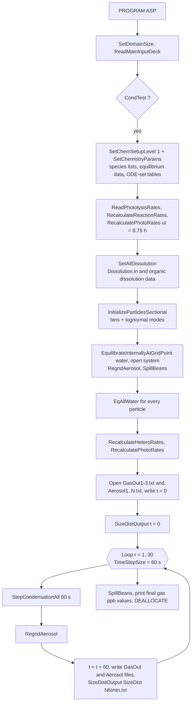
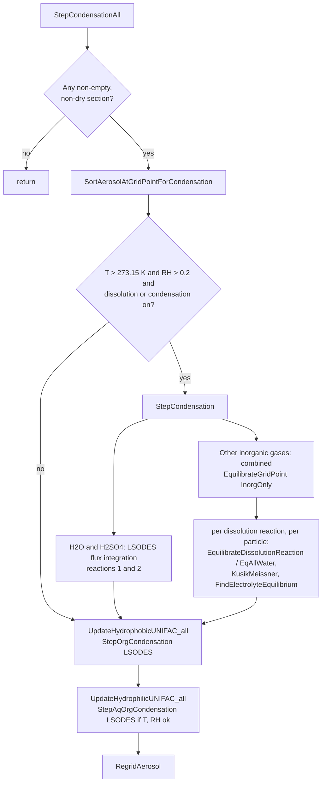

# ASP Model — Information Flow for `DevelopmentDriver.f90` with `CondTest = .TRUE.`

Source basis: `common_ASP` branch `asp_v_2.2.1`. Sections 1–5 were written against commit `deab03b` (patches 00–15) and their line numbers and profile refer to that tree; section 6 and 7 have been updated for patches 16–25 (branch tip `65d2ac9`, tag `asp_v_2.2.1`). Section 8 lists every patch that touches this mode.

## 1. Scope and purpose

This document traces the flow of control and data through the ASP source tree when:

- `DevelopmentDriver.f90` (`PROGRAM ASP`) is the main program, and
- the run-control flag `CondTest` (deck line "Condensation Test to compare to analytic solution", read into `ModelParameters`) is `.TRUE.`

In this mode ASP does **not** run gas chemistry, coagulation or transport. It builds the same static sectional (binned) aerosol population as the CoagTest, puts it in equilibrium with the water vapour at the deck's RH, and then lets inorganic and organic species **condense onto and dissolve into** the particles for a fixed 30 minutes in 1-minute steps. It writes the gas concentrations and each bin's contents every minute. Its purpose (per the comment in the driver) is to compare against an analytic condensation solution. No numeric values from any input deck are used below, only the structure of what is read, computed and written.

Unlike the CoagTest, the work here is almost all **aerosol thermodynamics** (electrolyte equilibrium for every particle, repeated many times per step), not a particle-pair kernel. Section 5 gives a measured profile.

## 2. High-level flow

`StepCondensationAll` (`CondensationIntegrator.h`) is where the time goes:

## 3. Step-by-step description

### 3.1 Program entry and branch selection

`PROGRAM ASP` calls `SetDomainSize`, `SetFileHandleCounter(12)` and `ReadMainInputDeck()`. The deck sets the run-mode flags (`EulerianBoxModel`, `OpticalPropertiesModel`, `LagrangianParcelModel`, `ThermoTest`, `CoagTest`, `CondTest`, `SmogChamberModel`), the environment (T, P, RH), and the condensation settings listed in section 4. The `IF / ELSE IF` chain then enters the `CondTest` block (`DevelopmentDriver.f90` ≈ lines 1389–1560). A line "Condensation Test Selected." is written to the transcript.

### 3.2 Chemistry setup (level 1)

`CALL SetChemSetupLevel(1)` then `CALL SetChemistryParams` (patch 07/N13). Level 1 reads the gas, aqueous, organic and hydrophilic-organic species definitions and the aqueous equilibrium reactions, builds the ODE-set tables, and skips the Jacobian and the printing of the ODE sets. It then calls `ReadPhotolysisRates`, `RecalculateReactionRates(IFGAS,IFAQ)` and `RecalculatePhotoRates(8.75, t, .TRUE.)` (a hard-coded universal time, "Timbavati initial universal time"). `Chem(HowManyGasChems)` is allocated. The photochemistry itself is never integrated in this mode; the rates are only set up.

### 3.3 Dissolution data

`SetAllDissolution` (`CondensationInitialization.h`) loads `Dissolution.in` and the hydrophobic and hydrophilic organic dissolution data: for each gas–particle reaction, the gas index, aqueous index, mass accommodation coefficient, Henry's law constants and the related aqueous equilibrium. (The CoagTest does not call this.)

### 3.4 Building and equilibrating the initial population

`InitializeParticlesSectional` (`LagrangianAerosols.f90`) is the same as in the CoagTest: `ReadDistributionsOrganic()` parses `AerosolModes.in` (bins, lognormal modes and composition), and `PopulateParticlesSectionsRightAway(.FALSE.)` creates one `Particle` section per bin and fills `AqChems`, `OrgChems` and `AqOrgChems`.

Then:

1. `EquilibrateInternallyAtGridPoint(EquilibrateWater=.TRUE., WaterOpenSystem=.TRUE.)` forces water equilibrium between the gas and the aerosol (open system, so the gas water vapour is fixed).
2. `RegridAerosol()` and `SpillBeans()`.
3. The driver counts the bins, allocates `NumConc(NumBins)`, and calls `EqAllWater(Current, ReturnType, .TRUE.)` for every particle (open system).
4. Number concentrations and radii are copied to `HeteroNumberConc` / `HeteroRadii` (radius cm to m) for `RecalculateHeteroRates`, and `RecalculatePhotoRates` is called again.
5. The NH3, HNO3, HCl and H2SO4 gas indices are looked up with `FindChem` for the final print-out.

### 3.5 Output files at t = 0

`3 + NumBins` file handles are obtained. `GasOut1.txt`, `GasOut2.txt` and `GasOut3.txt` are opened and given a header and the t = 0 row (`GasOutput`). One `AerosolK.txt` per bin is opened with a header and the t = 0 row (`AerosolOutput`). `SizeDistOutput(0, "SizeDist0min.txt")` follows.

### 3.6 Main time loop (30 iterations)

`TimeStepSize = 60.0` (hard-coded; the deck's condensation time step is not used in this branch), `DO r = 1, INT(30*60/TimeStepSize)`, i.e. 30 passes of 60 s. Each pass:

1. `CALL StepCondensationAll(TimeStepSize, 1)` (section 3.7).
2. `CALL RegridAerosol()` moves sections across bin boundaries, updates the temperature, and runs the thermodynamics for any particle that moved.
3. `t = t + 60`.
4. When the flux option is on (the normal case), `GasOutput` and `AerosolOutput` for every bin are written every pass, and `SizeDistOutput(t, "SizeDist<min>min.txt")` is written every minute.
5. `WRITE(*,*) <t> minutes done` to standard output.

If the deck selects equilibrium rather than flux (`DissolutionEquilibriumOrFlux = 0`), the loop exits after one pass and writes `SizeDist2.txt` instead.

After the loop: `SpillBeans()`, final gas values (NH3, HNO3, HCl, H2SO4, POA1) in ppb to standard output, and `DEALLOCATE`.

### 3.7 `StepCondensationAll` and what it calls

1. **Empty-cell test.** Loops over the particles; a section with at most 1e-40 particles, or a `Dry` particle, does not count. If every section is empty the routine returns.
2. **Equilibrium mode** (`DissolutionEquilibriumOrFlux = 0`): `StepCondensation` once and return. **Flux mode** (this document's case): `SortAerosolAtGridPointForCondensation`, then for each of `NumTimeSteps` (here 1):
   - If dissolution or condensation is on, and T > 273.15 K and RH > 0.2: `StepCondensation(TimestepSize, 1)`.
   - If hydrophobic organic dissolution is on: `UpdateHydrophobicUNIFAC_all` (UNIFAC activity coefficients), then `StepOrgCondensation`.
   - If hydrophilic organic dissolution is on: `UpdateHydrophilicUNIFAC_all`, then, if T and RH allow, `StepAqOrgCondensation`.
3. `RegridAerosol()`.

`StepCondensation` (≈ 1,270 lines in `CondensationIntegrator.h`):

- Allocates the LSODES work arrays (`y`, `rwork`, `iwork`) and `ChemStorageArray` for `HowManyLinks` sections, and records each section's number concentration.
- For each dissolution reaction `Rxn`: water (reaction 1) and sulfuric acid (reaction 2) are integrated as a stiff ODE system with `DLSODES` (gas concentration plus one aerosol concentration per section, with a sparse Jacobian from `CondensationJacobianEvaluator`). The rate coefficients come from `DissolutionFactors` and `CondensationRateCoefficients` (diffusion with Fuchs–Sutugin and ventilation corrections, Kelvin effect).
- With the combined inorganic dissolution option (`CombinedInorgDiss`, used in the current deck), all remaining inorganic gases (HNO3, HCl, NH3, ...) are not integrated by LSODES. They are handled once per step by `EquilibrateGridPoint(EquilibrateWater=.FALSE., InorgOnly=.TRUE.)` (operator splitting).
- Water uptake uses an iterative loop of `EqAllWater` per particle when RH is below the critical value.
- The results are written back into the gas-phase burden and into each particle, then per-particle thermodynamics are refreshed (`KusikMeissner`, `EquilibrateDissolutionReaction`).

`EquilibrateGridPoint` (`CondensationRelatedFunctions.h`) is the inner equilibrator: `DO WHILE (.NOT.Equilibrated)`, for each dissolution reaction, repeat `DO WHILE (.NOT.RxnEquilibrated)` over all sections with at least 1e-6 particles: `EqAllWater` (water), `ReformElectrolyte` and `EquilibrateDissolutionReaction` (individual gas–particle reactions), and `FindElectrolyteEquilibrium` for the aqueous electrolytes, with `KusikMeissner` after each dissolution reaction.

`FindElectrolyteEquilibrium` (`Thermodynamics.h`) solves the aqueous ionic equilibrium of one particle: it updates the mixed activity coefficients (`KusikMeissner`), equilibrates each aqueous dissociation reaction once (`EquilibrateAqueousDissociationReaction`, recursive), iterates a few more initial passes, then repeatedly finds and equilibrates the reaction furthest from equilibrium until all major reactions converge, and finally equilibrates the minor ones. `EquilibriumConstantsRatio` (which needs `EqCoeff`, `MeanActivity` and the molalities) is the quantity driving each step.

### 3.8 Output routines

- `GasOutput(fh1, fh2, fh3, t, ...)`: one row per call: time and gas concentrations for all gas species (three files).
- `AerosolOutput(Current, fh, t, ...)`: one row per call and bin: time, number, radius, and the aqueous, organic and hydrophilic-organic contents.
- `SizeDistOutput(t, name)`: one header row plus one row per bin.
- `SpillBeans()` writes RH, density and a full state dump to standard output.

## 4. Inputs consumed and outputs produced

**Inputs**

| File / source | Used for |
|---|---|
| `ASPInputDeck.in` | Run-mode flags (`CondTest`); T, P, RH; `Include Condensation`, inorganic, hydrophobic and hydrophilic dissolution flags; equilibrium (0) or flux (1); ammonia equilibrium or flux; metastable flag; diffusivity-correction flag |
| `AerosolModes.in` | Bin definition and lognormal modes and composition (different for each test deck) |
| `Dissolution.in` and organic dissolution data | `SetAllDissolution`: gas–particle reactions, Henry's law, accommodation coefficients |
| Species and equilibrium decks (`AqPhaseChems.in`, `AqPhaseIons.in`, `OrgPhaseChems.in`, `HydrophilicOrgChems.in`, `AqEquilibriumReactions.in`, `AerosolThermoKusikMeissner.in`, gas-phase files), `PhotoRates.in` | `SetChemistryParams`, photolysis set-up, thermodynamic data |
| Hard-coded in the driver | 60 s step, 30 steps (30 min), universal time 8.75 h for photolysis, per-minute output |

**Outputs (run output directory)**

| File | Content |
|---|---|
| `GasOut1.txt`, `GasOut2.txt`, `GasOut3.txt` | Header, t = 0 row, one row per step: gas species concentrations |
| `Aerosol1.txt` ... `AerosolN.txt` | One file per bin: row per step of that bin's number, radius and contents |
| `SizeDist0min.txt` ... `SizeDist30min.txt` | 31 size-distribution snapshots (one per minute) |
| Transcript and standard output | Banner, `SpillBeans` dumps, per-step "<t> minutes done", final gas values; the thermodynamics warnings (see section 6) |

## 5. Measured profile (Williams deck, at `deab03b`, before patches 16–25)

A callgrind run of the CondTest on the Williams deck (the only one of the three test decks that completes, see section 6) on the current branch (`asp_v_2.2.1`, optimized gfortran build) gives 54.4 G instructions in total, about 4.5 s of wall time. For comparison, the original `master` code takes about 15.7 s on the same deck (see the caveat in section 6 on comparing results).

| Part of the run | Instructions | Share |
|---|---|---|
| `StepCondensationAll` (30 calls) | 49.4 G | 91% |
| – `StepCondensation` | 47.9 G | 88% |
| –– `EquilibrateGridPoint` (30 calls, one per step) | 43.9 G | 81% |
| ––– `FindElectrolyteEquilibrium` (25,168 calls from it) | 38.0 G | 70% |
| –––– `EquilibrateAqueousDissociationReaction` | 38.7 G | 71% |
| ––––– `EquilibriumConstantsRatio` | 26.5 G | 49% |
| –––––– `MeanActivity` (70 M calls) | 15.4 G | 28% |
| libm `pow` (inside the above) | 12.8 G | 24% |
| `KusikMeissner` (inclusive) | 5.7 G | 10.5% |
| String comparisons (`_gfortran_compare_string`, including its `memcmp`) | about 3.6 G | 6.5% |
| `EquilibrateInternallyAtGridPoint` (start-up only) | 3.4 G | 6.3% |
| `SurfaceTension` | 2.2 G | 4% |
| `EqCoeff` (self) | 2.0 G | 3.7% |
| `StepOrgCondensation`, `StepAqOrgCondensation`, UNIFAC | about 1.4 G | about 2.6% |
| `DLSODES` (all LSODES calls for H2O, H2SO4) | 0.008 G | 0.015% |
| All output routines | about 0.06 G | 0.1% |
| `SetChemistryParams`, `InitializeParticlesSectional` | about 1.0 G | about 1.9% |

Call counts per 30 steps: `FindElectrolyteEquilibrium` ≈ 23 M (including internal re-entries), `EquilibrateAqueousDissociationReaction` ≈ 108 M, `EquilibriumConstantsRatio` ≈ 125 M, `MeanActivity` ≈ 70 M, and `KusikMeissner` 53 k times directly from `EquilibrateGridPoint` (more from the thermodynamics routines).

Reading: the stiff ODE integration is negligible. The cost is the repeated electrolyte equilibration, dominated by evaluating the equilibrium quotient of each aqueous reaction (powers, activity coefficients, name tests) about 100 M times.

## 6. Compatibility and issues found while preparing this document

- **Which decks run (status after patches 16–17: all three run).** The description below is of `deab03b`, kept for the record. Patch 16 (`5b4647e`) initialises `IonReset` in the `RegridAerosol` grow branch, which was the root cause of the empty-water, NaN-ionic-strength bin; patch 17 (`8766c40`) guards the tabulated Gibbs–Duhem integral against NaN (the "small fix" described below). With both, Timbavati and RemConMode1 run to completion under CondTest (75 output files each). The three test decks share `ASPInputDeck.in` and differ in `AerosolModes.in`. With the deck switched to CondTest (line 50 = 0, line 51 = 1), only the Williams deck runs to completion (30 steps). Timbavati and RemConMode1 stop early:
  - the original `master` code (with the BinEdges build fix only) prints "JOB ABORT DUE TO UNRECOVERED ERROR" from SLATEC (`DGAUS8`: "ANS is probably insufficient") after "Ionic Strength Error in PKweightings!" warnings, i.e. non-finite ionic strength in the initial equilibration;
  - the current branch **segfaults** in the same place: `GibbsDuhemIntegralTabulated` (`Thermodynamics.h`, added by patch N11) computes the table index `J = MIN(INT(S/H), N-1)` from `S = SQRT(IonicStrength)`; when `S` is NaN, `INT(S/H)` is undefined and the table is indexed out of range. The original code only ever called `DGAUS8`, which aborted cleanly. The fix is small (use the table only when `S` is finite, non-negative and not above the table's range, otherwise call `DGAUS8` as before). It would not change any result in the range where the table is valid. This is not applied yet.
  - Both failures are consistent with the particles in those two decks not being equilibrated before the condensation starts. A working CondTest therefore needs a deck whose initial composition can be equilibrated.
- **Results differ from the original code, by design.** On the Williams deck the current branch's CondTest output differs from the original `master` code. The initial gas concentrations differ (for example CO and O3 take the deck's values instead of those from the uninitialised `OLDASP` flag, patch 10), and the aerosol files differ too: about 3e-4 for the aerosol contents of the bin I checked (consistent with the tabulated Gibbs–Duhem integral, patch N11), and up to order-one relative differences in some size-distribution columns, which probably follow from the different gas concentrations. I did not analyse these further. So the reference for any CondTest optimization has to be a build of the current branch, not the original.
- **Standard output.** Each `StepCondensationAll` pass prints "---> Calling StepOrgCondensation if doing flux" and flushes unit 6; 30 times in total, negligible.
- **Hard-coded values.** Step size (60 s), run length (30 min), photolysis time (8.75 h) and the one-output-per-minute rule are in the driver.

## 7. Optimization hypotheses (from the profile above) and what became of them

Status after patches 16–25 (details in section 8): hypothesis 1 partly done (patches 19, and N8 earlier; exponent 2 is deliberately not shortcut), 2 partly done (patches 24 and 25 remove repeated evaluations inside one solver call; re-solving unchanged reactions across calls is not done), 3 done (patch 18), 4 not needed (cache exists), 5, 6, 7, 8 not done. The text of each hypothesis is left as originally written.

Every item below needs a bit-exactness check on CondTest outputs (the Williams deck, plus any other deck that works) before a change is kept, as with the CoagTest patches.

1. **`pow` in the equilibrium quotient (about 24% of the run).** `MeanActivity` and `EquilibriumConstantsRatio` evaluate `x**E` with real exponents read from `AqEquilibriaList` (`WaterActivity**..`, `CationMolality**E4`, `GammaMixed**(E4+E5)`). The exponents are reaction constants, usually small integers or simple fractions. Precomputing per reaction a code for the exponent (1, 2, 3, 1/2 ...) and using `x`, `x*x`, `sqrt(x)` where it gives the same bits, or caching `GammaMixed(k)**(E4+E5)` until `KusikMeissner` next changes `GammaMixed`, would remove most of the `pow` calls. Note that `x*x` and `pow(x,2)` may differ in the last bit on some libm versions, so this needs testing, not assuming.
2. **Re-evaluating the equilibrium quotient when nothing has changed (about 49% inclusive).** `EquilibriumConstantsRatio` is called about as often as `EquilibrateAqueousDissociationReaction` (≈ 125 M and ≈ 108 M times), and `CheckEquilibriumConvergenceForAqDissociationRxn` and the "find the worst reaction" scan evaluate it again for every reaction after each equilibration. Memoising the molalities, `MeanActivity` and `EqCoeff` per particle and invalidating them only when that particle's composition or `GammaMixed` changes would avoid recomputing unchanged reactions. This is the largest and most intricate item.
3. **String comparisons in hot paths (about 6.5%).** `EquilibrateAqueousDissociationReaction`, `CheckEquilibriumConvergence...`, `SurfaceTension` and others compare species names (for example `AqAnionNames(...) .EQ. "CO3--"` and `AqPhaseChemicalNames(...) .EQ. "(NH4)3H(SO4)2"`) on every call. The names depend only on the reaction number, so flags can be computed once per reaction when the equilibrium list is loaded (the same approach as patch N12 for the rate-type flag). This should be bit-exact.
4. **`EqCoeff` per call (3.7% self).** The temperature-dependent equilibrium coefficient of each reaction is constant while the temperature is constant (as in this test). Caching it per reaction keyed on temperature (and on the other inputs `EqCoeff` uses) should be bit-exact. An `EqCoeff` cache already exists elsewhere (patch N6–N11); it needs checking why `EqCoeff` is still this large here.
5. **`KusikMeissner` after every dissolution step (10.5% inclusive).** `EquilibrateGridPoint` refreshes the mixed activity coefficients of a particle after each dissolution reaction, and `FindElectrolyteEquilibrium` does it again on entry (`UpdateThermo`). If the composition has not changed since the last call the result is the same, so the call can be skipped. Whether the composition really is unchanged in most calls would need to be counted first.
6. **How often each section is re-equilibrated.** About 840 `FindElectrolyteEquilibrium` calls per step for a few tens of occupied sections means each section is equilibrated many times per step by the nested `DO WHILE` loops in `EquilibrateGridPoint`. An early exit for a section whose inputs are unchanged since its last equilibration would cut this directly. It may change the converged values at the level of the equilibrium tolerance, so it is not expected to be bit-exact; it needs a tolerance-based comparison like patch N11.
7. **`SurfaceTension` and `RecalculateRadius` (4%).** The same pair that dominates the CoagTest profile (`SurfaceTension` → `KusikMeissner` → `CalcLogGammaPure`). Here it is smaller, and its value is needed for the Kelvin term, so it cannot simply be skipped. Do this together with the CoagTest question (which run modes need the surface tension at that point) rather than separately.
8. **Per-section independence (not bit-exact).** Particles are equilibrated one after another with the gas burden updated in between, so they are not independent; a parallel version would change the order of gas updates. Not recommended here (the test machine has two cores anyway).
9. **Items not worth pursuing in this mode:** the LSODES integrations (0.015%), the output routines (0.1%), start-up (`SetChemistryParams`, `InitializeParticlesSectional`, about 2%), and the UNIFAC updates (about 1%).

Suggested order: 3 (easy and bit-exact), 4, 1, then 2 and 5 (the biggest, needing care), with 6 last because it may not be bit-exact.

Not yet determined: the number of occupied sections in each deck, how many `FindElectrolyteEquilibrium` calls per section per step are really needed, and the behaviour on decks other than Williams (which do not currently run).

## 8. Patches that affect this run mode (branch `asp_v_2.2.1`)

Verification used throughout: `cmp` of every file in `OutputFiles` except `Transcript.TXT` (which differs in its timing line). A CondTest run writes 75 files.

| Patch | Commit | Effect on CondTest | Result change |
|---|---|---|---|
| 00–15 | see `ASP_Patch_Summary.docx`, `ASP_CoagTest_Optimization_Summary.docx` | Optical-path, setup and thermodynamics speedups (N1–N13 etc.); N11 (tabulated Gibbs–Duhem integral) is the large one for this mode | N11 changes results by about 2e-4 relative (the original `DGAUS8` tolerance); patch 10 changes the initial gas concentrations (`OLDASP`) |
| 16 | `5b4647e` | `IonReset` initialised in `RegridAerosol` grow branch; lets Timbavati and RemConMode1 run | Bug fix. Williams unchanged |
| 17 | `8766c40` | Gibbs–Duhem table used only for `S >= 0` (NaN falls back to `DGAUS8`) | None on decks that already ran |
| 18 | `46b4665` | Per-reaction name flags instead of string compares | Byte-identical |
| 19 | `86d3a78` | `PowMemo` for repeated `x**y` | Byte-identical |
| 20 | `189da4e`, `d6ee616` | Input-deck switch for N11 (`GDTableMode` 1 = table, 0 = full `DGAUS8`; `GDTableCells`, default 256). Optional last lines of `ASPInputDeck.in`; defaults apply if omitted | None at the defaults. `GDTableMode = 0` reproduces the original integral |
| 21–23 | `22dbf94`, `2f83092`, `97e1d64` | Gas-chemistry solver and `LagrangianParcel` driver only; not used by CondTest | None |
| 24 | `f08134b` | `EquilibriumConstantsRatio` evaluated once at entry of `EquilibrateAqueousDissociationReaction` and reused | Byte-identical |
| 25 | `9e33a67` | Per-reaction `AqEquilibriaList` reads and index arithmetic done once before the iteration loop; inline NaN test | Byte-identical |

Check made for this document: a build at patch 19 (`0671d9f`) and a build at the branch tip were run on Williams, Timbavati and RemConMode1 with only the Condensation Test flag set. All 75 files of each deck are byte-identical between the two builds, so patches 20–25 do not change CondTest output. Wall time on the two-core container, one run each (noisy, about 5–10%): Williams 5.08 s to 4.28 s, Timbavati 4.90 s to 4.35 s, RemConMode1 3.81 s to 3.06 s. Instruction counts were not re-measured for this mode after patch 19 (46.8 G, 51.6 G and 31.1 G for Williams, Timbavati and RemConMode1 in `ASP_CondTest_Optimization_Summary.docx`).

Not yet done for this mode: the profile in section 5 has not been repeated after patches 24 and 25, and `SurfaceTension` (hypothesis 7) is untouched, awaiting the run-mode test noted in `ASP_Pending_Patch_Notes.md`.
