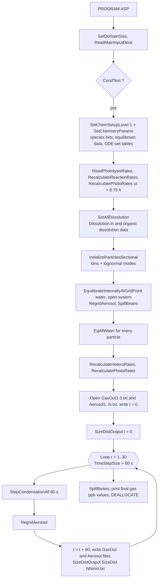
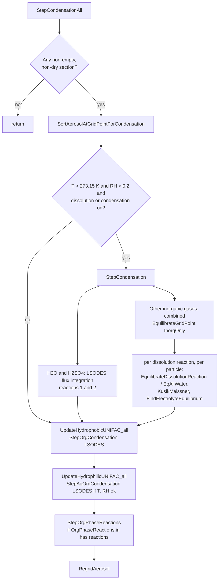

# ASP information flow: condensation test (`CondTest`)

How control and data move through `common_ASP` when `DevelopmentDriver.f90` (`PROGRAM ASP`) runs with the deck flag
"Condensation Test to compare to analytic solution" set (`CondTest = .TRUE.` in `ModelParameters`). The history of the
changes behind this design, with timings and their effect on results, is in `CHANGELOG.md`.

## 1. Scope

In this mode ASP runs **condensation and dissolution only**: no gas chemistry, coagulation or transport. It builds the
same static sectional aerosol population as the coagulation test, puts it in equilibrium with the water vapour at the
deck's RH, and lets inorganic and organic species condense onto and dissolve into the particles for a fixed 30 minutes
in 1-minute steps, writing the gas concentrations and each bin's contents every minute. Its purpose (per the comment in
the driver) is comparison with an analytic condensation solution.

Almost all the work is **aerosol thermodynamics**: the electrolyte equilibrium of every particle, repeated many times
per step (section 5).

## 2. High-level flow

`StepCondensationAll` (`Condensation/CondensationIntegrator.h`) is where the time goes:

## 3. Step by step

### 3.1 Program entry and branch selection

`PROGRAM ASP` calls `SetDomainSize`, `SetFileHandleCounter(12)` and `ReadMainInputDeck()`. The deck sets the run-mode
flags, the environment (T, P, RH) and the condensation settings of section 4. The driver's `IF / ELSE IF` chain enters
the `CondTest` block and writes "Condensation Test Selected." to the transcript.

### 3.2 Chemistry set-up (level 1)

`SetChemSetupLevel(1)`, then `SetChemistryParams`: species definitions and aqueous equilibrium reactions, and the
ODE-set tables, without the Jacobian and without printing the ODE sets. Then `ReadPhotolysisRates`,
`RecalculateReactionRates(IFGAS, IFAQ)` and `RecalculatePhotoRates(8.75, t, .TRUE.)` (a universal time set in the
driver, "Timbavati initial universal time"), and `Chem(HowManyGasChems)` is allocated. The photochemistry is never
integrated in this mode; the rates are only set up.

### 3.3 Dissolution data

`SetAllDissolution` (`Condensation/CondensationInitialization.h`) loads `Dissolution.in` and the hydrophobic and
hydrophilic organic dissolution data: for each gas–particle reaction, the gas index, aqueous index, mass accommodation
coefficient, Henry's law constants and the related aqueous equilibrium.

### 3.4 Building and equilibrating the initial population

`InitializeParticlesSectional` is the same as in the coagulation test (`ASP_CoagTest_InformationFlow.md`, section 3.3).
Then:

1. `EquilibrateInternallyAtGridPoint(EquilibrateWater=.TRUE., WaterOpenSystem=.TRUE.)` brings the aerosol to water
   equilibrium with the gas (open system: the water vapour is fixed).
2. `RegridAerosol` and `SpillBeans`.
3. The driver counts the bins, allocates `NumConc(NumBins)` and calls `EqAllWater(Current, ReturnType, .TRUE.)` for
   every particle.
4. Number concentrations and radii are copied to `HeteroNumberConc` / `HeteroRadii` (cm to m) for
   `RecalculateHeteroRates`, and `RecalculatePhotoRates` is called again.
5. The NH₃, HNO₃, HCl and H₂SO₄ gas indices are looked up with `FindChem` for the final print-out.

### 3.5 Output files at t = 0

`GasOut1.txt`, `GasOut2.txt` and `GasOut3.txt` get a header and the t = 0 row (`GasOutput`); one `AerosolK.txt` per bin
gets a header and the t = 0 row (`AerosolOutput`); `SizeDistOutput(0, "SizeDist0min.txt")` follows.

### 3.6 Main time loop (30 iterations)

`TimeStepSize = 60.0` is set in the driver (the deck's condensation step is not used in this mode);
`DO r = 1, INT(30*60/TimeStepSize)`, 30 passes. Each pass:

1. `StepCondensationAll(TimeStepSize, 1)` (section 3.7).
2. `RegridAerosol` moves sections across bin boundaries, updates the temperature, and runs the thermodynamics for any
   particle that moved.
3. `t = t + 60`.
4. In flux mode (the normal case) `GasOutput` and `AerosolOutput` for every bin, and
   `SizeDistOutput(t, "SizeDist<min>min.txt")`, every pass.
5. "<t> minutes done" to standard output.

If the deck selects equilibrium rather than flux (`DissolutionEquilibriumOrFlux = 0`), the loop exits after one pass and
writes `SizeDist2.txt` instead. After the loop: `SpillBeans`, the final NH₃, HNO₃, HCl, H₂SO₄ and POA1 values (ppb) to
standard output, and `DEALLOCATE`.

### 3.7 `StepCondensationAll` and what it calls

1. **Empty-cell test.** A section with at most 1e-40 particles, or a `Dry` particle, does not count; if every section is
   empty the routine returns.
2. **Equilibrium mode** (`DissolutionEquilibriumOrFlux = 0`): `StepCondensation` once and return. **Flux mode**:
   `SortAerosolAtGridPointForCondensation`, then for each of `NumTimeSteps` (here 1):
   - if dissolution or condensation is on and T > 273.15 K and RH > 0.2: `StepCondensation(TimestepSize, 1)`;
   - if hydrophobic organic dissolution is on: `UpdateHydrophobicUNIFAC_all` (UNIFAC activity coefficients), then
     `StepOrgCondensation`;
   - if hydrophilic organic dissolution is on: `UpdateHydrophilicUNIFAC_all`, then, if T and RH allow,
     `StepAqOrgCondensation`;

   then `StepOrgPhaseReactions(TimestepSize*NumTimeSteps)`: first-order particle-phase organic reactions from the
   optional `OrgPhaseReactions.in` (nothing without the file).
3. `RegridAerosol`.

`StepCondensation`:

- Allocates the LSODES work arrays and `ChemStorageArray` for `HowManyLinks` sections and records each section's number
  concentration.
- Water (dissolution reaction 1) and sulfuric acid (reaction 2) are integrated as a stiff ODE system with `DLSODES`: the
  gas concentration plus one aerosol concentration per section, with a sparse Jacobian from
  `CondensationJacobianEvaluator`. The rate coefficients come from `DissolutionFactors` and
  `CondensationRateCoefficients` (diffusion with Fuchs–Sutugin and ventilation corrections, Kelvin effect).
- With combined inorganic dissolution (`CombinedInorgDiss`, used in the test decks) the other inorganic gases (HNO₃,
  HCl, NH₃, ...) are not integrated by LSODES; they are equilibrated once per step by
  `EquilibrateGridPoint(EquilibrateWater=.FALSE., InorgOnly=.TRUE.)` (operator splitting).
- Water uptake uses an iterative loop of `EqAllWater` per particle when RH is below the critical value.
- The results are written back into the gas-phase burden and each particle, then per-particle thermodynamics are
  refreshed (`KusikMeissner`, `EquilibrateDissolutionReaction`).

`EquilibrateGridPoint` (`Condensation/CondensationRelatedFunctions.h`) is the inner equilibrator: until equilibrated,
for each dissolution reaction, repeat over all sections with at least 1e-6 particles: `EqAllWater` (water),
`ReformElectrolyte` and `EquilibrateDissolutionReaction` (gas–particle reactions), and `FindElectrolyteEquilibrium` for
the aqueous electrolytes, with `KusikMeissner` after each dissolution reaction.

### 3.8 The electrolyte solver

`FindElectrolyteEquilibrium` (`LagrangianParticles/Thermodynamics.h`) wraps `FindElectrolyteEquilibriumCore`, which
solves the aqueous ionic equilibrium of one particle:

1. Update the mixed activity coefficients (`KusikMeissner`) when asked (`UpdateThermo`).
2. Equilibrate each aqueous dissociation reaction once (`EquilibrateAqueousDissociationReaction`, recursive). The single
   reaction is solved by safeguarded Newton on ln(ratio) inside Jacobson's bracket (`AqInnerSolver = 1`, default) or
   by Jacobson's bisection (`AqInnerSolver = 0`).
3. Outer solve, selected by `AqOuterSolver`:
   - **1 (default):** `CoupledElectrolyteNewton` solves all movable reactions together for ln(ratio) = 0 with
     activity coefficients, water activity, water amount and temperature fixed (analytic Jacobian, mass and charge
     exact, solids by complementarity). `PreAssociate` first sets strongly sub-equilibrium dissolved electrolytes
     directly. The **solid-circuit rule** (`InitSolidCircuits`, `ResolveUnstableSets`, `StableSideAvailable`;
     `AqPairRule`) prevents precipitation from completing the thermodynamically unstable side of a linearly dependent
     set of 2–4 solids. A validation pass of single-reaction solves follows each Newton cycle; on a singular Jacobian
     solids are dropped by DRH order, cumulatively, then by subsets; a nearly dry particle goes to `DrySolve` (minimum
     Gibbs energy of the solid assemblage); if all fail, the particle is restored and the worst-first loop runs.
   - **0:** the worst-first loop: opening sweeps, then repeatedly equilibrate the reaction furthest from equilibrium
     until all major reactions converge (`AqExitFix` controls the early exit; `AqDevCache` caches unchanged
     deviations), then the minor reactions.
4. `EquilibriumConstantsRatio` gives each reaction's distance from equilibrium from the molalities, `MeanActivity` and
   `EqCoeff` (cached per reaction and temperature). It keeps a by-value memo of its last result per reaction;
   `PowMemo` reuses repeated `x**y`; species-name tests are precomputed per reaction (`InitEqRxnNameFlags`).
5. The water activity uses the Gibbs–Duhem integral, tabulated per reaction and temperature
   (`GibbsDuhemIntegralTabulated`, `GDTableMode = 1`, `GDTableCells` cells; it falls back to `DGAUS8` for a
   non-finite or negative ionic strength) or integrated with `DGAUS8` on every call (`GDTableMode = 0`).

`FEEStateHook`, called around each solve, lets the test harness in `Tests/` dump and replay solver inputs; the model
never sets it.

### 3.9 Output routines

- `GasOutput`: one row per call with time and the concentrations of all gas species (three files).
- `AerosolOutput`: one row per call and bin with time, number, radius and the aqueous, organic and hydrophilic-organic
  contents.
- `SizeDistOutput`: a header row and one row per bin.
- `SpillBeans`: RH, density and a full state dump to standard output.

## 4. Inputs and outputs

**Inputs**

| File / source | Used for |
|---|---|
| `ASPInputDeck.in` | run-mode flag (`CondTest`); T, P, RH; condensation and the inorganic, hydrophobic and hydrophilic dissolution flags; equilibrium (0) or flux (1); ammonia equilibrium or flux; metastable flag; diffusivity-correction flag; optional solver settings at the end (`README.md`) |
| `AerosolModes.in` | bin definition, lognormal modes and composition |
| `Dissolution.in` and the organic dissolution decks | `SetAllDissolution`: gas–particle reactions, Henry's law, accommodation coefficients |
| Species and equilibrium decks, `PhotoRates.in` | `SetChemistryParams`, photolysis set-up, thermodynamic data |
| `OrgPhaseReactions.in` (optional) | particle-phase organic reactions |
| Set in the driver | 60 s step, 30 steps, universal time 8.75 h for photolysis, output every minute |

**Outputs** (75 files)

| File | Content |
|---|---|
| `GasOut1.txt`, `GasOut2.txt`, `GasOut3.txt` | header, t = 0 row, one row per step: gas concentrations |
| `Aerosol1.txt` ... `AerosolN.txt` | one file per bin: one row per step with number, radius and contents |
| `SizeDist0min.txt` ... `SizeDist30min.txt` | 31 size-distribution snapshots |
| `Transcript.TXT`, standard output | banner, `SpillBeans` dumps, "<t> minutes done", final gas values, thermodynamics warnings |

## 5. Where the time goes

A callgrind profile of the Williams deck (October 2026, before the solver changes of November) put 91% of the run in
`StepCondensationAll`, 81% in `EquilibrateGridPoint` and about 70% in `FindElectrolyteEquilibrium`, with
`EquilibriumConstantsRatio` (49%), `MeanActivity` (28%) and libm `pow` (24%) inside it; the LSODES integrations were
0.015% and the output 0.1%. About 840 `FindElectrolyteEquilibrium` calls per step for a few tens of occupied sections
means each section is re-equilibrated many times per step by the nested loops of `EquilibrateGridPoint`. Later changes
(caches, memos, the Newton and coupled solves) reduced the cost of each solve but not this structure; the
profile has not been repeated since. A 30-minute run takes 0.5–2 s on the test decks (November 2026).
