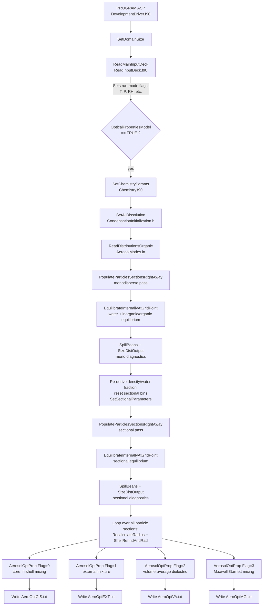

# ASP Model — Information Flow for `DevelopmentDriver.f90` with `OpticalPropertiesModel = .TRUE.`

## 1. Scope and purpose

This document traces the flow of control and data through the ASP (Aerosol Simulation Program) source tree when:

- `DevelopmentDriver.f90` (`PROGRAM ASP`) is compiled and run as the main program, and
- the run-control flag `OpticalPropertiesModel` (set in the main input deck and stored in `ModelParameters`) is `.TRUE.`

Under this configuration, ASP does **not** run a time-stepped Lagrangian, Eulerian, or smog-chamber simulation. Instead it performs a **single-pass calculation**: it builds one static, internally-mixed, multi-mode aerosol population from user-specified size/composition inputs, equilibrates it thermodynamically, and computes its bulk optical properties (extinction, single-scattering albedo, asymmetry parameter, backscatter) under several internal-mixing assumptions. No specific numeric values from any input deck are used below — only the structure of what is read, computed, and written.

## 2. High-level flow



## 3. Step-by-step description

### 3.1 Program entry and global setup

`PROGRAM ASP` (`DevelopmentDriver.f90`) begins execution and pulls in module data (not code) from `ModelParameters`, `InfrastructuralCode`, `GridPointFields`, `Chemistry`, `Aerosols`, `Condensation`, `OutputRoutines`, and `Coagulation`. These `USE` statements expose module-level state and driver-callable subroutines/functions; they do not by themselves move data.

1. **`CALL Random_Seed()`** — initializes the Fortran intrinsic random-number generator (used later for any stochastic aerosol placement, if invoked).
2. **Welcome banner** written via `Transcript` (an ASP logging routine in `InfrastructuralCode` that writes to both the console and a transcript file).
3. **`CALL SetDomainSize()`** (`ModelParameters`) — fixes the model domain to its default single-box volume (ASP has operated as a 0-D/1-box model since the Eulerian grid was removed).
4. **`CALL SetFileHandleCounter(12)`** — initializes the pool of Fortran logical unit numbers that `GetFileHandle`/`ReturnFileHandle` hand out for all subsequent file I/O, so unit numbers are never reused while in use.
5. **`CALL ReadMainInputDeck()`** (`ReadInputDeck.f90`) — the single entry point for reading the top-level control file. This is where the model learns *which* mode to run.

### 3.2 `ReadMainInputDeck()` — main control-file parsing

This subroutine opens the primary input deck (in the `InorganicInputDecks/` sub-directory) and, sequentially, parses:

- **Section 1 — Process control**: integer (0/1) flags read line-by-line for whether gas-phase chemistry, aqueous-phase chemistry, condensation, coagulation, and related sub-processes are active, and whether the coagulation kernel is constant or calculated. Each flag is validated (must be an integer, must be 0 or 1) and pushed into `ModelParameters`/`Chemistry` module state via setter calls (e.g., `SetGasChemistryFlag`).
- **Section 2 — Run-mode selection**: a further sequence of 0/1 flags determines which top-level driver branch executes: `SetLagrangianParcelModel`, `SetEulerianBoxModel`, `SetSmogChamberModel`, **`SetOpticalPropertiesModel`**, `SetThermoTest`, `SetCoagTest`, `SetCondTest`, and `SetSubroutineModel`. These are mutually-exclusive run modes; the driver later tests them in an `IF/ELSE IF` chain. For this document, `SetOpticalPropertiesModel` is the one that ends up `.TRUE.`
- **Section 3 — Run parameters**: ambient temperature, pressure, relative humidity, and other scalar run parameters are read as real numbers and passed to `GridPointFields` (e.g., via `InitializeGridPointFields`, `SetWaterVaporField`) so that later grid-point queries (`GetTemp`, `GetM`, `GetRelativeHumidity`, …) return consistent values.
- Additional sections (not exercised by the Optical-Properties branch but still parsed because the deck is read sequentially) configure emissions, photolysis, mixing/dilution, and output timing for the other run modes.

`ReadMainInputDeck` also calls `SetInputDeckSubDir`/`SetOutputDeckSubDir` (fixing the directories all later `OPEN` statements will read from/write to) and opens the run's transcript log file.

Control returns to `PROGRAM ASP` with all run-mode flags and scalar run parameters now stored in module state.

### 3.3 Branch selection in the main program

Back in `DevelopmentDriver.f90`, the driver tests the run-mode flags in order:

```
IF (EulerianBoxModel) THEN ...
ELSE IF (OpticalPropertiesModel) THEN ...      <-- this branch, per the task
ELSE IF (LagrangianParcelModel) THEN ...
...
```

Because `OpticalPropertiesModel` was set `.TRUE.` by the input deck, execution enters this branch and none of the other run-mode branches execute.

### 3.4 Chemistry and thermodynamic initialization

Before any particles exist, the branch initializes the chemical mechanism and dissolution/partitioning data that the aerosol-equilibrium routines will need:

1. **`CALL SetChemistryParams`** (`Chemistry.f90`) — a convenience wrapper that, in turn, calls:
   - `SetGasPhaseChemistry` — reads the gas-phase species list and reaction set (from a `GasPhaseChems.in`-type deck) into `Chemistry` module arrays.
   - `SetAqPhaseChemistry` — reads the aqueous-phase species/ions list (from `AqPhaseChems.in` / `AqPhaseIons.in`-type decks).
   - `SetOrgPhaseChemistry` — reads the hydrophobic organic species list (`OrgPhaseChems.in`).
   - `SetHydrophilicOrgPhaseChemistry` — reads the hydrophilic organic species list (`HydrophilicOrgChems.in`).
   - If gas chemistry is active: sets up the ODE/Jacobian structures and integrator constants for gas-phase kinetics.
   - If aqueous chemistry is active: sets up the aqueous-phase ODE/Jacobian structures.
   - Always: `SetAqPhaseEquilibriumReactions` — reads the aqueous equilibrium (dissociation) reaction list (`AqEquilibriumReactions.in`-type deck) and the Kusik–Meissner activity-coefficient data, which the aerosol thermodynamic solver uses regardless of whether kinetic aqueous chemistry is active.

   All of the above populate module-level chemical-species tables (names, molecular masses, densities, phase membership) that downstream routines (`FindChem`, `AqMolecularMass`, `OrgMolecularMass`, etc.) query by species name/index — no simulation time-stepping happens here.

2. **`CALL SetAllDissolution`** (`CondensationInitialization.h`, part of the `Condensation` module) — reads the gas/particle dissolution (Henry's-law / vapor-pressure) parameter decks for inorganic species (`Dissolution.in`), hydrophobic organics (`OrganicDissolution.in`), and hydrophilic organics (`HydrophilicOrganicDissolution.in`), storing them for use by the equilibrium/partitioning routines called later.

3. Elapsed-CPU-time is logged via the intrinsic `etime` and written to the transcript for performance tracking; this has no effect on model results.

### 3.5 Building the initial (monodisperse) aerosol population

The branch's own inline comments describe the intended algorithm (reproduced here generally, without numeric specifics):

1. **`Particles%First => Null()`** — the particle linked list (the core ASP aerosol data structure, one node per size "section"/bin) is reset to empty.
2. **`CALL SetInitialDens(...)`** (`ModelParameters`) — seeds a first-guess particle density used before composition-dependent density can be computed.
3. **`CALL ReadDistributionsOrganic()`** (`InitializationAndSamplingRoutines.h`, part of the `Aerosols`/particle-initialization code) — opens the aerosol mode/size-distribution input deck (an `AerosolModes.in`-type file) and:
   - Reads whether Lagrangian particles are allowed or a purely sectional distribution is forced.
   - Reads whether composition is specified as mass or number ratios.
   - Reads, for each aerosol **mode** (an externally-mixed sub-population, e.g. "mode 1", "mode 2", …), the mode's size-distribution parameters and its relative composition (mass or number fractions of each aqueous, organic, and — implicitly — water species).
   - Populates the module-level `AerosolModes` array (rows = modes, columns = size parameters followed by per-species composition fractions).
4. **`Monodisperse = .TRUE.`; `InputFlagRatioOrMass = 1`** — temporarily configures the particle-population routine to build one single-size ("monodisperse") particle per mode rather than a full sectional (binned) size distribution, and to treat the composition input as a mass ratio.
5. **`CALL PopulateParticlesSectionsRightAway(.FALSE.)`** (same file as `ReadDistributionsOrganic`) — using the `AerosolModes` array, builds actual `Particle` linked-list node(s) with the specified relative dry composition (excluding water, which is not yet known). The `.FALSE.` argument indicates this is the primary (not boundary/environmental) aerosol population.
6. **`CALL SizeDistOutput(0.0, "SizeDist_Opt_Mono.txt")`** (`OutputRoutines.f90`) — writes the just-created monodisperse size distribution to disk as a diagnostic/checkpoint file, tagged at model time 0.
7. **`CALL EquilibrateInternallyAtGridPoint(EquilibrateWater=.TRUE., WaterOpenSystem=.TRUE.)`** (`CondensationRelatedFunctions.h`, `Condensation` module) — the core thermodynamic solver. For every particle in the linked list it:
   - Sorts/compacts the particle list.
   - Iteratively solves aqueous electrolyte dissociation/association equilibria (`FindElectrolyteEquilibrium`, `ReformElectrolyte`, Kusik–Meissner activity coefficients) and, because `EquilibrateWater = .TRUE.` with `WaterOpenSystem = .TRUE.`, simultaneously equilibrates particle water content against the (open, i.e. non-depleting) ambient water vapor reservoir at the run's relative humidity.
   - Updates each particle's chemical-species arrays (`AqChems`, `OrgChems`, `AqOrgChems`) and, via `RecalculateRadius`, its physical radius and density in place.
8. **`CALL SpillBeans()`** (`OutputRoutines.f90`) — writes a full-state text dump (gas- and particle-phase concentrations, RH, etc.) to the transcript/output area; a standard ASP diagnostic checkpoint, not used as input to later steps.

At this point the model has one physically-equilibrated, water-containing particle per input mode, and from it extracts (without recomputing chemistry) the **water content** and **bulk density** that resulted from equilibration — these become inputs to building the full sectional distribution next.

### 3.6 Building the sectional (multi-bin) aerosol population

1. The saved water mass and density from the monodisperse particle are used to (re-)normalize each mode's composition array (`AerosolModes`) so that water is included as an explicit mass-fraction component alongside the aqueous and organic species, and all fractions for each mode sum to unity.
2. **`CALL SetSectionalParameters(...)`** (`ModelParameters`) — defines the sectional (binned) size grid: an upper diameter/radius bound, a lower bound, and a number of bins/sections spanning them (values are run-specific and not reproduced here).
3. **`Monodisperse = .FALSE.`; `InputFlagRatioOrMass = 0`; `Particles%First => Null()`** — the particle list is cleared again and the population routine is reconfigured to build a full multi-bin sectional distribution using mass-fraction (not ratio) composition input.
4. **`CALL PopulateParticlesSectionsRightAway(.FALSE.)`** — rebuilds the particle linked list, this time as a full set of sectional bins per mode, each seeded with the (now water-inclusive) composition fractions and the sectional size grid from step 2.
5. **`CALL SizeDistOutput(0.0, "SizeDist_Opt_Sect_init.txt")`** — diagnostic dump of the sectional distribution *before* re-equilibration.
6. **`CALL EquilibrateInternallyAtGridPoint(EquilibrateWater=.TRUE., WaterOpenSystem=.TRUE.)`** — the same thermodynamic solver as in §3.5, now applied to every section of every mode, bringing the full sectional population to aqueous/organic/water equilibrium at the run's ambient conditions.
7. **`CALL SpillBeans()`** — full-state diagnostic dump.
8. **`CALL SizeDistOutput(0.0, "SizeDist_Opt_Sect.txt")`** — diagnostic dump of the final, equilibrated sectional distribution.

This two-pass approach (monodisperse-then-sectional) exists specifically so that the water content and density used to seed the full sectional distribution are physically consistent with equilibrium at the run's relative humidity, rather than being guessed.

### 3.7 Per-particle optical properties (refractive index and single-particle Mie efficiencies)

For every particle (section) in the now-equilibrated linked list, the driver loops with `DO WHILE (ASSOCIATED(current))` and, for each one:

1. **`CALL RecalculateRadius(current)`** (`ParticleAttributes.h`, `Aerosols` module) — recomputes the particle's physical radius from its current chemical composition by calling the composition-dependent density function, then updates the particle's surface tension; ensures radius/density are consistent with the equilibrated composition before optics are computed.
2. **`CALL ShellRefIndAndRad(current)`** (`ParticleAttributes.h`) — the optical-property engine for a single particle. It:
   - Holds hard-coded, wavelength-dependent complex refractive-index look-up tables (real and imaginary parts) for black carbon/soot, water, water-soluble organic material, insoluble material, sea salt, sulfate, and dust, sourced from the OPAC v3.1a dataset, spanning UV through far-IR.
   - Computes each chemical species' volume concentration within the particle from its equilibrated mass and molar volume/density.
   - Combines species-level refractive indices into an **effective shell (non-BC) refractive index** and a separate **absorbing core (black-carbon) refractive index**, at each of the tabulated wavelengths, using volume-weighted mixing.
   - Also computes refractive indices for the alternative mixing assumptions used later: a volume-average dielectric-constant mixture and a Maxwell-Garnett effective-medium mixture.
   - Determines the particle's **core radius** (from BC volume) and **overall/shell radius** (from total particle volume).
   - **`CALL DMiLay(...)`** (`DMiLay.f`, a coated-sphere / core-shell Mie-scattering routine) — computes, per wavelength band, the single-particle extinction efficiency, scattering efficiency, backscattering efficiency, and asymmetry parameter for a concentric core-in-shell sphere (BC core, mixed-composition shell). This is called multiple times per particle: once for the core-in-shell configuration and again for the external-mixture, volume-average, and Maxwell-Garnett refractive-index cases, storing results in parallel per-particle arrays (`ExtEff`, `ScaEff`, `BackScaEff`, `AssymParam`, and the `…BC`, `…Shell`, `…VA`, `…MG` variants).
   - The companion Mie code `MIEV0.f` / `MieLay.f` are available in the repository for homogeneous-sphere Mie calculations used elsewhere in the codebase (e.g., single-composition or non-core-shell cases); `DMiLay` (coated sphere) is the routine exercised on the core-in-shell path from `ShellRefIndAndRad`.

After this loop, every particle in the linked list carries wavelength-resolved single-particle optical efficiencies for all four mixing-rule variants.

### 3.8 Population-integrated (bulk) optical properties

**`CALL AerosolOptProp(ExtCoeff, SingScat, Assym, BackScatCoeff, SubExtCoeff, SubSingScat, Flag)`** (`ParticleAttributes.h`) is called **four times**, once per mixing-rule `Flag`:

| Flag | Mixing rule | Uses per-particle arrays |
|---|---|---|
| 0 | Core-in-shell (default) | `ExtEff`, `ScaEff`, `AssymParam` |
| 1 | External mixture of BC and rest | `ExtEffBC`/`ExtEffShell`, `ScaEffBC`/`ScaEffShell`, weighted by each particle's BC volume fraction |
| 2 | Volume-average dielectric-constant internal mixture | `ExtEffVA`, `ScaEffVA`, `AssymParamVA` |
| 3 | Maxwell-Garnett internal mixture | `ExtEffMG`, `ScaEffMG`, `AssymParamMG` |

For each call, `AerosolOptProp` loops over all 451 wavelength bands and, within each band, sums the number-weighted, geometric-cross-section-weighted contribution of every particle to bulk extinction and scattering coefficients and to the scattering-weighted asymmetry parameter; it separately accumulates a "submicron" total restricted to particles below a 1 µm diameter threshold. After the particle loop it derives, per band:

- **Single-scattering albedo** = scattering coefficient / extinction coefficient (total and submicron).
- **Asymmetry parameter** = scattering-weighted sum / total scattering coefficient.
- **Extinction and submicron-extinction coefficients**, unit-converted from cm⁻¹ to Mm⁻¹.
- **Hemispheric backscatter coefficient**, from the asymmetry parameter via the Wiscombe & Grams (1976) Henyey–Greenstein approximation, likewise converted to Mm⁻¹.

These six output arrays (`ExtCoeff`, `SingScat`, `Assym`, `BackScatCoeff`, `SubExtCoeff`, `SubSingScat`), each dimensioned over the 451 wavelength bands, are returned to the driver.

### 3.9 Output to disk

After each of the four `AerosolOptProp` calls, the driver:

1. Obtains a free file unit via `GetFileHandle()`.
2. Opens a text file in the run's output directory (`OutputDeckSubDir`), named for the mixing rule used:
   - `AeroOptCIS.txt` — core-in-shell (Flag = 0)
   - `AeroOptEXT.txt` — external mixture (Flag = 1)
   - `AeroOptVA.txt` — volume-average dielectric mixing (Flag = 2)
   - `AeroOptMG.txt` — Maxwell-Garnett mixing (Flag = 3)
3. Writes a header row (`Wavelength`, `ExtCoeff (Mm^-1)`, `SSA`, `<g>`, `BackScat (Mm^-1)`, `SubExtCoeff`, `SubSSA`) followed by one row per wavelength band (band index converted to a wavelength value, plus the six computed quantities for that band).
4. All four file handles are collected in an allocatable array (`OutFH`) and released together with `DEALLOCATE` once all four files are written.

No time-stepping loop, gas-phase kinetics integration, coagulation, or condensation dynamics occur in this branch — those are only exercised by the Lagrangian Parcel, Eulerian Box, and chamber/test branches of the same `IF/ELSE IF` chain, which are skipped entirely when `OpticalPropertiesModel = .TRUE.`

### 3.10 Program termination

After the `OpticalPropertiesModel` branch completes (falling through the `ELSE IF` chain), the program reaches its closing statements: it computes total elapsed CPU time (`etime`) and writes it to the transcript, then terminates (`END PROGRAM ASP`). The chamber/aerosol-test-specific `DEALLOCATE` statements near the end of the file apply to variables used only by the Smog Chamber branch and are not reached on this code path.

## 4. Summary: inputs consumed and outputs produced

**Inputs read (file identities only, contents not detailed):**
- Main control deck (run-mode flags, T/P/RH, process on/off switches) — read by `ReadMainInputDeck`.
- Gas-phase, aqueous-phase, organic-phase, and hydrophilic-organic species decks, plus the aqueous equilibrium-reaction deck — read by `SetChemistryParams` and its sub-calls.
- Inorganic, organic, and hydrophilic-organic dissolution/partitioning decks — read by `SetAllDissolution`.
- Aerosol mode/size-distribution and composition deck — read by `ReadDistributionsOrganic`.

**Outputs written:**
- `SizeDist_Opt_Mono.txt`, `SizeDist_Opt_Sect_init.txt`, `SizeDist_Opt_Sect.txt` — size-distribution diagnostics at successive stages.
- Transcript/`SpillBeans` full-state dumps — general diagnostics.
- `AeroOptCIS.txt`, `AeroOptEXT.txt`, `AeroOptVA.txt`, `AeroOptMG.txt` — the four bulk aerosol-optical-property spectra (wavelength vs. extinction, SSA, asymmetry parameter, backscatter, and their submicron counterparts), one file per internal-mixing assumption.

**Core computational engine used:** `DMiLay` (core-shell Mie scattering), fed by wavelength-dependent OPAC refractive-index data mixed according to four alternative rules (core-in-shell, external mixture, volume-average dielectric, Maxwell-Garnett), applied to a thermodynamically-equilibrated (via `EquilibrateInternallyAtGridPoint`) sectional aerosol population built from user-specified mode/size/composition inputs (via `ReadDistributionsOrganic` and `PopulateParticlesSectionsRightAway`).

## 5. Patches that affect this run mode (branch `asp_v_2.2.1`)

The description above is of the code path as read; the patches below change how it is implemented, not what it computes, except where a result change is stated. Details, timings and verification are in `ASP_Patch_Summary.docx` (00–10) and the other summaries named in the table.

| Patch | Where | Effect on this mode | Result change |
|---|---|---|---|
| 00 | `ModelParameters.f90` `SetSectionalParameters` | `BinEdges` is deallocated before the second `ALLOCATE` (this mode calls it twice; gfortran aborts otherwise) | None |
| 01, 02 | `ShellRefIndAndRad` | OPAC tables made module constants; refractive-index category lookups hoisted | Byte-identical |
| 03 (N1–N5) | `StripToken`, `MakeJacobian`, `EquilibriumConstantsRatio`, `MeanActivity`, `EquilibrateAqueousDissociationReaction` | Remove redundant setup and equilibrium work | Byte-identical |
| 04 (N6–N11) | Gibbs–Duhem integrand, `EqCoeff` cache, `pow(x,1)`, tabulated integral | N11 is the largest speedup | N6–N10 byte-identical; N11 about 2e-4 relative in the `AeroOpt*` files (more in a few size-distribution bins) |
| 05 | `ShellRefIndAndRad` | MIEV0 for the four homogeneous-sphere Mie calls (call 1 stays on `DMiLay`) | At most about 1e-5 relative against the N1–N11 build |
| 06, 07 | `MakeODESet`, `SetChemSetupLevel` | Gas ODE set and Jacobian are not built in this mode (setup level 2); `GasPhaseODESet.txt` and `GasPhaseJacobian.txt` are no longer written | None in numerical files |
| 08–10 | `MakeMonodisperse`, particle creation, `OLDASP` | Uninitialised values removed. Patch 10 changes the initial gas concentrations (CO 1.0e4 ppb from the deck instead of 75.8 ppb) | `AeroOpt*` identical; the gas columns of the `SizeDist_Opt` files and the transcript change |
| 12 | `7c15ef6` | `MakeSection(1,J)` in `PopulateParticlesSectionsRightAway` | None (checked on the three decks at RH 0.20, 0.55, 0.90) |
| 16–19, 24, 25 | `Thermodynamics.h`, `RegridAerosol` | Shared thermodynamics improvements (see `ASP_CondTest_InformationFlow.md` section 8) | Byte-identical in this mode (check below) |
| 20 | `ReadInputDeck.f90`, `Thermodynamics.h` | Optional deck lines `GDTableMode` and `GDTableCells`; `GDTableMode = 0` restores the original `DGAUS8` integral | None at defaults |

Check made for this document: builds at patch 15 (`89d60a6`) and at the branch tip were run on Williams, Timbavati and RemConMode1 with the Optical Properties Model flag set (the decks' default relative humidity). All 8 output files of each deck are byte-identical between the two builds (`Transcript.TXT` excluded), so patches 16–25 do not change the optical-mode results at that humidity. Only that one humidity was run, not the 45-run sweep used for patches 00–10.
